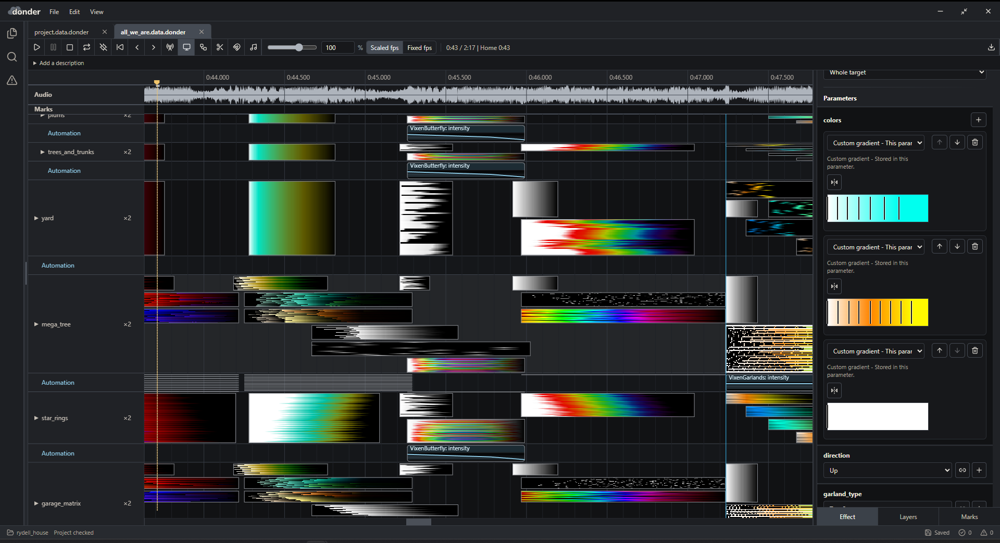
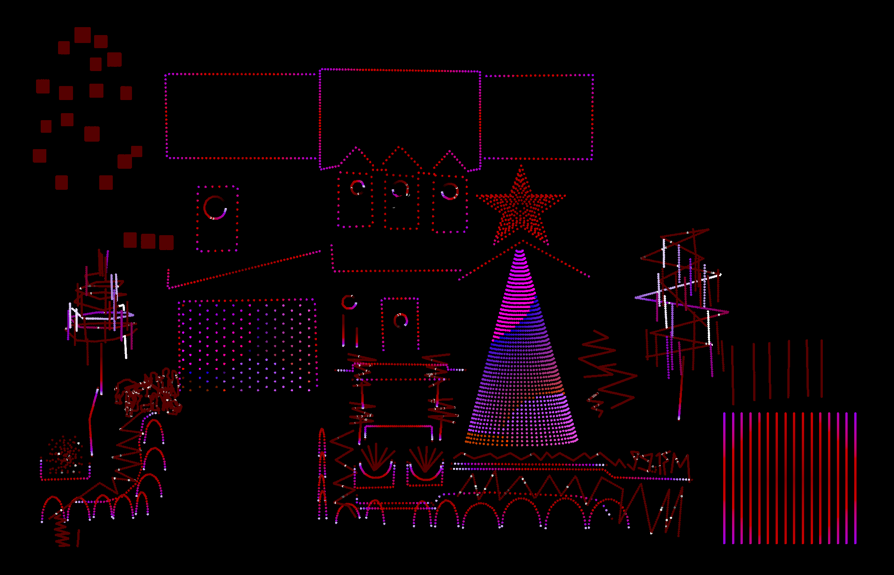
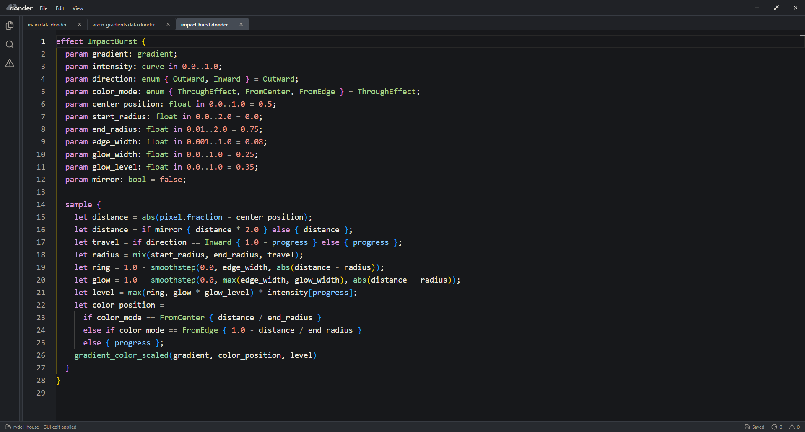
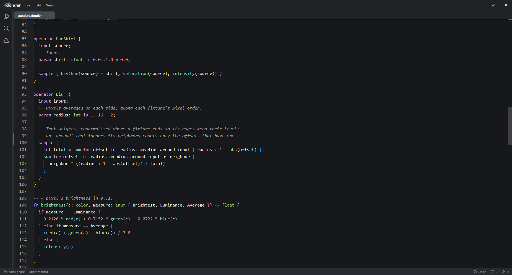

# Donder

Donder is a light show sequencer where every effect is a program. This has a few advantages:
- Sequences are compiled programs that can be evaluated by the Donder runtime, which is fast and small enough to fit on a microcontroller. This means that a stock ESP32 can store and play back a minutes-long sequence at high framerates without the use of external memory or networking.
- Because shows aren't pre-rendered like in xLights or Vixen, live input is almost trivial with Donder's runtime. When input is received, the runtime can immediately render effects on the fly.
- Effect parameters can be tuned and automated in real time. Effects can have user-defined parameters like hue, brightness, fade speed, etc, which are all declared and used as variables in the Donder DSL.
- Sequences can be divided into layers, which can be composed using something called operators. Operators (which can also be custom written in the Donder DSL) are used to apply visual effects to different layers of a sequence. Operator examples include things like dim, blur, bloom, or afterglow.
- Every part of a profile is modular. Sequences, fixtures, operators, effects, controller configs, etc. can all be shared between different users and integrated into different shows.









You don't need to write code to use Donder. It ships with a library of effects
and operators, and everything has a graphical editor. When you want something
the library doesn't have, you can write it yourself (or ask an LLM to write it for you).

## What makes it different

- **Effects and sequences are programs** Every effect, including every bundled one, is a
  short program you can open, change or copy. Sequences are timelines containing effects
  and operators that can be played back by the Donder runtime. An effect computes one color per
  pixel per frame from the pixel's position, time, beat marks, curves and
  gradients. → [Effect language](docs/effect_language.md),
  [tutorial](docs/effect_tutorial.md) This is similar to something like PixelBlaze,
  but Donder's DSL is an array language (similar to APL or shader languages), so sequences
  can be evaluated at near native performance compared to a traditional VM.
  For example, **PixelBlaze claims performance of 30 fps for 800 LEDs on a single
  ESP32, whereas Donder can run at around 100 fps with 300 pixels on
  4 different outputs on the same hardware (this can vary depending on how many stacked effects
  and operators you have in a sequence)**.
- **A layer graph** Layers feed a node graph of operators:
  blends, dimming, hue shifts, blurs, blooms, trails, afterglows, mirrors.
  Operators are written the same way as effects, and they can sample their
  inputs at any pixel and their own previous frame. An afterglow is one line:
  `sample { max(input, previous * pow(decay, frames_elapsed)) }`.
  → [Operator inputs](docs/effect_language.md#operator-inputs)
- **Automation like a DAW.** An automation clip is a curve on the timeline that
  can drive any number of effect and operator parameters at once. Beat marks
  retrigger effects. Donder detects a song's beats and bars for you, or you can
  tap marks in while it plays.
  → [Sequences](docs/project_language.md#sequences)
- **The whole show is text.** Fixtures, layouts, patching, controllers and
  sequences are plain documents in one language. They diff cleanly in git and
  import each other, so a fixture, gradient or effect can be shared across
  shows. `donder check` validates a project the way a compiler does. That also
  makes it so an LLM can set up fixtures, patch controllers, or edit a sequence and get
  exact errors back. → [Project language](docs/project_language.md)
  <!-- TODO: link the registry website once it is public. -->
- **GUI and code are the same project.** Switch between the graphical editor and
  the text view at any time. Every editor state is a document, every edit can be
  undone, and saving never rewrites a token you typed. A language server gives
  any editor diagnostics, completion and navigation (`donder lsp`).
- **Play it live.** A console maps buttons to effects: a key starts a chase, taps a
  beat a running effect follows, or drives a parameter while held. Only the
  button presses travel; every device that plays the console renders the frames
  itself. → [Live input](docs/live_input.md)
- **Plays on multiple platforms.** Stream live over E1.31 or Art-Net, export an FSEQ
  file and schedule it in FPP next to your existing shows, or upload to an ESP32
  with the Donder VM. The preview, the live output and the firmware run
  the same runtime, and their frames match checksum for checksum.
  → [ESP32 controllers](docs/esp32_loading.md)

## Installation

Download the installer for Windows, macOS or Linux from
[donder.eddierydell.com/download](https://donder.eddierydell.com/download), or
[try the sequencer in your browser](https://donder.eddierydell.com/demo). The
preview builds are unsigned, so the download page explains how to open them.

To build from source, install the Rust toolchain from
`rust-toolchain.toml`, the Node.js and pnpm versions required by `package.json`,
and the [Tauri 2 system dependencies](https://tauri.app/start/prerequisites/)
for your platform. Then:

```bash
pnpm install
pnpm tauri dev
```

Open `examples/starter/project.data.donder` to explore a 30-output project with
sample sequences and every bundled effect and operator, or follow
[Create your first LED show](docs/first_show.md) to build one from scratch.

The command-line tool checks projects and exports FSEQ files:

```bash
cargo run -p donder-cli -- --path examples/starter check
cargo run -p donder-cli -- --path examples/starter render layer_test --at 1s
cargo run -p donder-cli -- --path examples/starter export-fseq layer_test show.fseq
```

## Learn more

The user guides are also published at
[donder.eddierydell.com/docs](https://donder.eddierydell.com/docs).

- [Create your first LED show](docs/first_show.md)
- [Write an effect](docs/effect_tutorial.md)
- [Fixture authoring](docs/fixture_authoring.md): lines, arcs, grids and
  matrices, layouts and groups
- [ESP32 controllers](docs/esp32_loading.md): install, upload and standalone
  playback
- [Performance](docs/performance.md) and [architecture](docs/architecture.md)
- [All documentation](docs/README.md)

## Status

Donder is pre-release and moving fast. Project and show formats change
without migrations for now.

Donder is currently very un user friendly. A lot of the UI is very vibe coded but I'm
working on tuning it to be more intuitive and less janky. If you have trouble with something
when creating a sequence or editing a profile, you can always ask an LLM to figure it
out for you. I've found this works especially well for setting up layouts and fixtures. The
layout, controllers and patch of an xLights or Vixen profile import into a new project with
File > Import Profile; see [profile import](docs/profile_import.md).

Standalone playback supports classic ESP32 boards with 4 MB flash, including the
QuinLED Dig-Quad, with up to 1,600 pixels on four outputs per controller. Larger
displays use live E1.31/Art-Net output or FSEQ export.

Not yet supported:
- Code-signed installers
- Non-pixel DMX fixtures such as moving heads
- Audio input, and live input on a standalone ESP32. Consoles play
  from the computer keyboard, MIDI and OSC today; see [live input](docs/live_input.md).

## License

Donder is released under the [MIT License](LICENSE).

## Contributing

See [development](docs/development.md) for the repository layout and the checks
to run before submitting changes.
